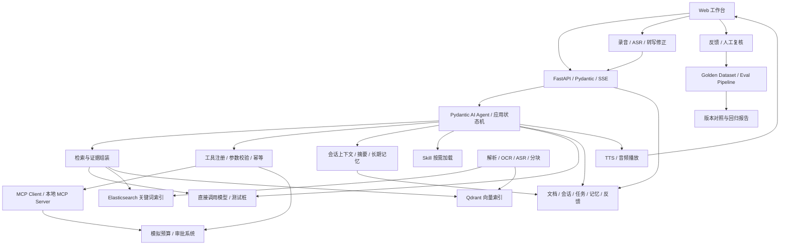

# 总体设计

## 1. 目标和范围

建设单用户本地 AI 办公实验应用，覆盖 RAG、动态任务规划、多轮对话与记忆、Tool Calling/MCP/Skill、翻译、多模态、ASR/TTS 和反馈评测闭环。采用 Pydantic 校验接口参数，Pydantic AI 实现 Agent；先采用模块化单体，文档入库等长任务按需交给 Worker。

仍不建设统一模型网关、权限与审计、性能与成本治理、SDD 或 AI Coding 提效实验。当前已引入 Pydantic AI 并默认接入 DeepSeek；已实现范围以 [实施状态](./04-implementation-status.md) 为准。

项目回答以下问题：

1. 如何检索到正确资料，并生成有依据的回答？
2. 如何让模型调用工具、推进任务并处理失败？
3. 工作流、单 Agent、多 Agent 分别适合什么任务？
4. 翻译和多模态知识接入如何建立可复现的质量评价？
5. 如何利用历史对话与长期记忆，在工具失败或用户改意图后调整计划？
6. 如何把真实反馈变成可复用评测样本，并完成语音输入到语音输出的任务？

## 2. 贯穿业务场景

| 场景 | 示例任务 | 交付结果 | 核心验证 |
|---|---|---|---|
| 制度问答 | 项目采购超过预算时需要什么审批？ | 带来源、版本和页码的回答 | 检索、引用、无证据拒答 |
| 预算分析 | 查询 P1001 预算使用情况并找出异常 | 工具计算结果和制度依据 | 工具调用、数据关联 |
| 审批处理 | 根据异常生成审批草稿并提交 | 可编辑草稿、确认记录、唯一单据 | 状态推进、恢复、幂等 |
| 翻译 | 将采购说明翻译为英文，保留术语和编号 | 原文译文对照、术语检查结果 | 工作流与翻译质量 |
| 多模态检索 | 查找会议录音、扫描件和截图中的采购依据 | 文本证据、页码或时间戳 | OCR、ASR、引用定位 |
| 多轮任务 | “查 P1001 的预算”“它还能采购多少？”“改为 P2002” | 解析后的项目与任务状态 | 指代消解、上下文切换、记忆纠正 |
| 语音办公 | 说出“查预算并读出异常” | 可修正转写、带引用文本和可播放音频 | ASR → Agent/RAG → TTS |
| 反馈改进 | 标记答案引用错误并填写正确来源 | 经复核的样本与回归报告 | 反馈分类、Golden Dataset、Eval Pipeline |

合成数据包括制度版本、预算台账、采购合同和会议材料，加入同名项目、过期制度、缺失信息和矛盾材料。金额由业务代码计算，模型组织解释。

主流程：

1. 接收任务并识别项目，有歧义时请求用户选择。
2. 预算工具读取业务快照，检索模块读取有效制度版本。
3. 规则代码计算异常，模型结合证据形成说明。
4. 生成草稿，保存业务版本、摘要和引用。
5. 用户确认具体草稿，校验草稿与业务版本后提交至模拟审批系统。
6. 保存单据 ID 和步骤结果；失败时恢复或进入待核对状态。

## 3. 架构与技术选择

| 模块 | 默认选择 | 用途与取舍 |
|---|---|---|
| 后端 | Python + FastAPI + Pydantic | API、参数校验、检索和模型调用 |
| Web | 简单对话与任务页，后续可用 React + TypeScript | 展示引用、执行步骤和草稿确认 |
| 数据 | PostgreSQL | 文档版本、会话、检查点、幂等记录和审批状态 |
| 检索 | Elasticsearch BM25 + Qdrant | 对比关键词、向量及混合检索；需处理双索引一致性 |
| 参数与结果 | Pydantic | API 请求响应、工具参数、规划结果和草稿结构；业务规则另行验证 |
| Agent | Pydantic AI + 应用状态机 | 框架负责 Agent 循环，应用保存计划版本、检查点与业务状态；不并行引入 LangGraph |
| 模型 | Pydantic AI 直接连接选定模型服务 | Ollama 可选，也可使用云端模型；模型服务仍负责实际推理 |
| 工具接入 | 本地函数工具 + MCP | 同一预算查询能力对比进程内调用与协议调用 |
| 技能 | Agent Skills 格式 + 应用加载器 | 按任务加载说明和资源；记录 Skill 版本，不默认运行附带脚本 |
| 记忆 | 关系数据库存事实，按需向量索引 | 原始消息、会话摘要、任务状态与长期记忆分别保存 |
| 语音 | ASR/TTS 各接入一种可用服务或本地引擎 | 先录音文件输入和整段音频输出；实现时锁定引擎与版本 |
| 评测闭环 | 现有 Python 评测脚本扩展 | 反馈复核、数据集版本、自动评分与人工质量对照 |
| 环境 | Docker Compose 按阶段启动组件 | 支持本地复现实验 |

基础版可先使用向量检索，P2 再加入 ES；未完成双路实现时不能标记混合检索实验完成。保留普通应用日志和步骤记录用于调试与评测。框架分工与新增能力详见 [Agent、记忆、语音与反馈设计](./05-agent-memory-voice-feedback.md)。

## 4. RAG 与知识接入

### 入库

原始文件 → 内容哈希与版本 → 解析/OCR/ASR → 结构化段落 → 分块 → Embedding → 索引写入 → 发布版本。

- 先支持 Markdown/TXT，再加入原生文本 PDF、DOCX、扫描件、图片和音视频。
- 表格保留列名、单位和行标识；分块保留标题上下文。
- 分块记录 `document_id/version/chunk_id/source_location/content_hash`，图片和音视频保留页码或时间戳。
- 入库任务可重复执行，使用唯一键避免重复片段。双索引完成后才发布新版本；查询只使用已发布版本。
- 文档删除后标记不可检索，再清理索引；候选结果按元数据过滤，避免旧数据进入回答。
- 分别记录文档数、成功解析数、分块数与向量数。

### 查询

用户问题 → 查询改写 → BM25 / 向量召回 → RRF 融合 → Rerank → 上下文组装 → 带引用回答或拒答。

改写保留项目编号、金额和时间条件，并与原查询联合召回。先固定生成模型与提示词，分别验证改写、混合召回、重排和分块的作用。混合检索与 RRF 参考 [Elastic 官方文档](https://www.elastic.co/docs/solutions/search/hybrid-search)。

上下文组装处理去重、长度上限、版本冲突和证据完整性。引用必须对应本次实际检索片段；无证据、证据矛盾或制度过期时明确说明，不编造依据。

## 5. 工作流、Agent 与工具

用相同任务集、工具集合和步骤上限比较三种模式：

- 确定性工作流：代码规定步骤，模型负责提取和生成。
- 单 Agent：用 Pydantic AI 运行“规划 → 执行 → 检查结果 → 继续/澄清/重新规划”循环，设置最大步骤数与超时。
- 多 Agent：检索、预算分析、审阅分工，通过结构化结果协作。

工作流与 Agent 的执行路径区别参考 [Anthropic 架构说明](https://www.anthropic.com/research/building-effective-agents)。多 Agent 是否保留，由任务成功率和错误分析决定。

工具定义包含名称、输入输出 Schema、读写类型、超时、重试策略和幂等要求。模型提供业务参数，代码执行校验、金额计算和业务状态变更。

任务状态：`created → running → awaiting_confirmation → running → succeeded`，另有 `awaiting_input/failed/cancelled`。缺少项目等必要信息时进入 `awaiting_input`，用户补充后继续。步骤保存输入输出引用、尝试次数、错误分类和检查点；计划单独保存版本和调整原因。

写入顺序：参数与业务规则检查 → 确认摘要及版本检查 → 幂等记录 → 调用模拟系统 → 保存结果。确认后修改草稿必须重新确认，防止提交内容与用户看到的内容不一致。

对“对端已提交、本地未收到结果”的情况，通过幂等键查询模拟审批系统；不能直接重发创建请求。Worker 重启后从检查点恢复。取消任务不自动撤销已经完成的业务写入。

模型调用保留请求超时、有限重试和中断提示，避免任务无限等待；流式内容已输出后明确返回中断状态，不重复追加回答。

## 6. 接口与数据契约

| 接口 | 用途 | 约束 |
|---|---|---|
| `POST /v1/documents` | 上传并创建入库任务 | 文件格式、大小、内容哈希 |
| `GET /v1/ingestions/{id}` | 查询入库进度 | 状态与错误分类 |
| `POST /v1/chat` | RAG 对话，支持 SSE | 消息 ID、来源、中断事件 |
| `POST /v1/runs` | 创建业务任务 | `client_request_id` 去重、运行模式 |
| `GET /v1/runs/{id}` | 查看步骤与结果 | 状态、输入输出引用、错误原因 |
| `POST /v1/runs/{id}/confirm` | 确认草稿 | 确认 ID、草稿哈希、业务版本 |
| `POST /v1/runs/{id}/cancel` | 取消任务 | 明确已经完成的业务写入 |
| `GET /v1/citations/{id}` | 查看来源 | 文档版本、页码或时间戳；删除后返回不可用 |
| `POST /v1/runs/{id}/input` | 回答澄清问题并恢复任务 | 输入 ID、运行版本，防止旧回复误推进新计划 |
| `GET /v1/memories` | 查看长期记忆 | 来源、作用范围、有效状态 |
| `PATCH /v1/memories/{id}` | 修正或替代记忆 | 版本检查、替代关系 |
| `DELETE /v1/memories/{id}` | 删除记忆 | 检索与摘要同步失效 |
| `POST /v1/audio/transcriptions` | 上传录音并转写 | MIME、大小、时长与转写片段 |
| `POST /v1/audio/speech` | 从已完成回答生成语音 | 回答 ID、声音与语言配置，返回音频资源 ID |
| `GET /v1/audio/{id}` | 播放生成音频 | 音频类型与关联文本版本 |
| `POST /v1/feedback` | 提交回答或工具结果反馈 | 消息/运行 ID、类别、修正依据 |
| `POST /v1/feedback/{id}/review` | 人工复核反馈 | 采纳/拒绝、修正标注和理由 |
| `POST /v1/evaluations` | 对固定数据集运行评测 | 数据集与提示词版本、配置快照 |
| `GET /v1/evaluations/{id}` | 查看逐题结果与对照 | 汇总、失败样例与原始记录引用 |

核心实体：`Project/Document/DocumentVersion/Chunk/Conversation/Run/Step/ToolExecution/ApprovalDraft/Confirmation`；新增 `PlanVersion/ConversationSummary/MemoryItem/SkillVersion/AudioAsset/Transcript/Feedback/EvalDataset/EvalCase/EvalRun`。下列为目标接口设计；当前具体路由与参数以运行服务的 `/docs` 为准。

## 7. 翻译与多模态扩展

翻译采用术语检索 → 翻译 → 数字/实体/格式检查 → 审阅流程，再与直接翻译、单 Agent 和多 Agent 比较。保存原文、术语表版本、配置、译文和人工评分。

多模态对比两条路线：OCR/ASR 转文本后检索，以及原生视觉理解或多模态 Embedding。前者便于核对但可能丢失版面与图表含义，后者需验证引用定位能力。音视频回答应能回到原始时间段，图片回答应能回到原图或对应区域。

图片处理验证识别、抽取和翻译；不将图片生成混入知识检索质量。每条路线保留解析结果和失败样本，区分解析错误、召回错误与生成错误。
